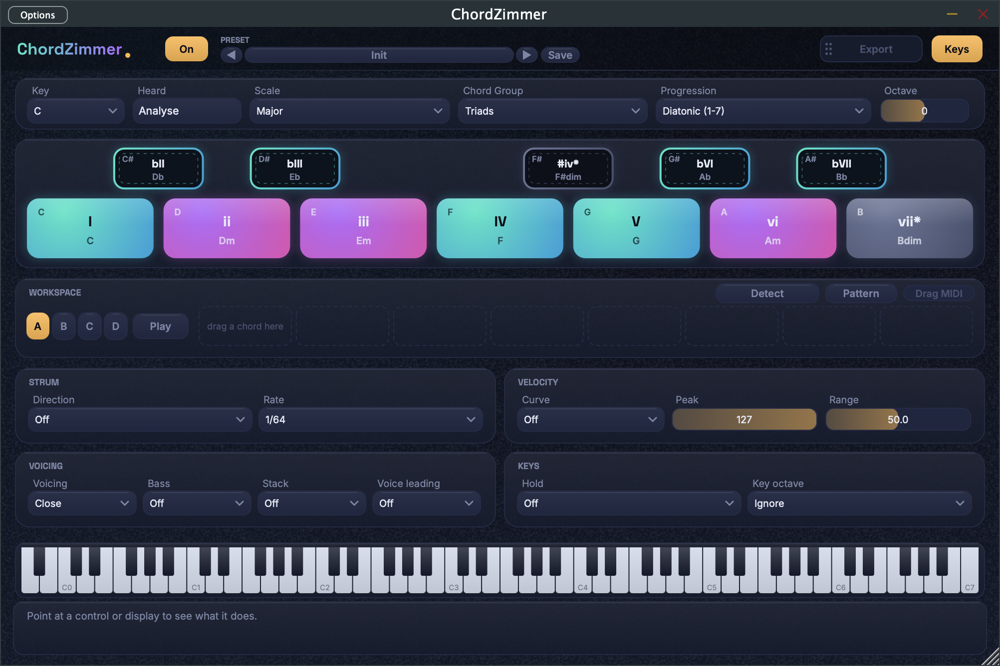

# ChordZimmer

A MIDI chord plug-in (VST3) for Ableton Live on macOS that brings Klimper 2's way of making chords
to Live: a **chord palette** by scale degree and complexity, colour-coded by chord family and
marked in or out of key; **borrowing** around the circle of fifths and from parallel modes; a
section-based **progression timeline**; **matching chords to a melody**; and drag-out to MIDI
clips. It makes no sound itself: it sends MIDI to an instrument on another track. It's a fork of
[ChordMonkey](../chordmonkey). The plan and its status are in [PLAN.md](PLAN.md).

ChordZimmer copies Klimper's *behaviour* only: no code, artwork, sounds, manual text or name.

**Version 0.0.1** (Phase 0, 2026-11-24). What changed: [CHANGELOG.md](CHANGELOG.md).



**Status:** Phase 0 of 9 is done: the fork, the new identity and the **Night Studio** look
(PLAN.md §5.1). The editor is still ChordMonkey's layout (chord pads, a workspace of patterns, the
performance cards), restyled; the palette, key navigator and timeline replace it in Phases 1–4.

## Build, test, install

Needs Xcode and JUCE 8.0.14 at `~/Development/JUCE` (or `--juce DIR`).

```bash
Tests/run_tests.sh
```

```bash
Tools/install.sh --validate
```

The first runs the core tests (plain C++, no JUCE). The second builds the VST3 and the Standalone
(Release, universal), signs them ad hoc, installs them in `~/Library/Audio/Plug-Ins/VST3` and
`~/Applications`, and runs `pluginval` at strictness 10. User presets live in
`~/Music/ChordZimmer/Presets/`.

## In Live

Turn on *Use VST3 Plug-In System Folders* (Settings → Plug-Ins) and rescan. Put ChordZimmer on a
MIDI track, and give an instrument track *MIDI From: <that track> → ChordZimmer* with Monitor *In*.

## Licence

Apache License 2.0 ([LICENSE](LICENSE)). The embedded fonts, Space Grotesk and Inter, are under
the SIL Open Font License 1.1 ([Resources/Fonts](Resources/Fonts)).
